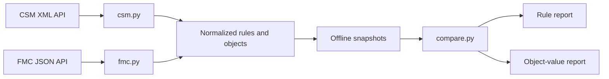

# PolicyCompare

**Python tooling for reviewing Cisco CSM-to-FMC firewall-policy migration drift.**

PolicyCompare separately compares rule references and the values of referenced network/service objects. It helps reviewers find missing rules and object changes without treating a partial comparison as proof of traffic equivalence.

Built from a network-security operations use case. The public demo uses synthetic data and runs without Cisco servers or credentials.

## Reviewer quick start — no network access

Python 3.12 or newer:

```bash
python compare.py examples/csm.json examples/fmc.json
```

This example deliberately changes an object's network value. The rule report passes, the object report fails, and the process exits with **1**. To see a matching comparison:

```bash
python compare.py examples/csm.json examples/csm.json
```

Expected exit code: **0**. Offline comparison uses only the standard library; API collection needs additional dependencies.

## Comparison scope

| Report | Compared | Outside its scope |
| --- | --- | --- |
| Rules | Source/destination object names and destination protocol/port ranges; missing/extra signatures in both directions | Rule order, action, enabled state, source ports |
| Objects | Values of referenced network/service objects, including named groups and nested members, matched by name and type | Objects not referenced by the selected policy |

FQDN, ICMP, CSM local policies, and device-specific object overrides are unsupported in this collection path. A match is **not** proof of equivalent effective firewall behavior. Incomplete inputs must not be accepted as a match.

Target compatibility: CSM 4.25 and FMC 7.6.5+. Actual API compatibility requires validation in an authorized lab.

## Architecture



Collection adapters are separate from comparison logic. `normalization.py` canonicalizes networks, protocols, and port ranges. `response_validation.py` checks API response shapes, `lab.py` controls explicit collection, and `snapshots.py` supports offline review.

## Optional API collection

Pinned dependencies target Windows and Python 3.12:

```powershell
py -3.12 -m venv .venv
.\.venv\Scripts\python.exe -m pip install --only-binary=:all: --require-hashes -r requirements.txt
.\.venv\Scripts\python.exe -m pip check
```

Validate settings without contacting servers:

```powershell
.\.venv\Scripts\python.exe lab.py --csm-url https://csm.example.invalid/nbi --fmc-url https://fmc.example.invalid --csm-policy example-policy --fmc-policy example-policy --fmc-version 7.6.5 --output-dir reports/run-001
```

Live collection requires `--connect` and prompts for credentials. Supply trusted CA bundles with `--csm-ca` and `--fmc-ca`. TLS verification is enabled by default. The existing `--insecure` development option disables certificate verification; prefer trusted CA bundles.

## Reports and exit codes

JSON/text reports: `rules_report.*` and `objects_report.*`. Live collection also saves normalized snapshots and `run.json`. Choose a fresh output directory per run.

| Exit | Meaning |
| --- | --- |
| 0 | Match within documented scope |
| 1 | Differences found |
| 2 | Invalid/incomplete input or execution failure |

Real snapshots and reports contain infrastructure information. Keep them private.

## Documentation and validation

- [Synthetic example and expected outcome](examples/README.md)
- [Hebrew operating guide](RUN_GUIDE_HE.txt)
- [Security notes](SECURITY.md)
- Offline tests: `python -m unittest discover -s tests -v`

No live Cisco environment was contacted for the portfolio demo. Offline validation does not establish production readiness.
